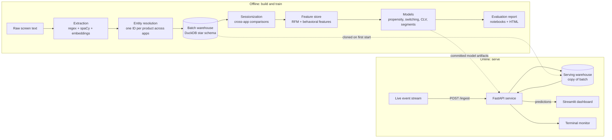

# Consumer Telemetry: Cross-App Shopping Behavior Pipeline

An end-to-end machine learning system that turns raw text captured from shopping app screens
into structured product events, stores them in an analytical warehouse, engineers per-user
behavioral features, trains models that predict what each shopper will do next, and serves
those predictions live through an API and a dashboard.

**Status:** version 1.0 is complete. Extraction, feature engineering, modeling, and the serving
layer (API, live event stream, dashboard, Docker images and Compose stack) are built, tested with
270 passing tests, and deployed locally with Docker. Public hosting is deferred to future work.
See [Project Status](#project-status), [Deployment](#deployment), and [Future Work](#future-work).

---

## Contents

1. [Project Aim](#project-aim)
2. [What Makes This Different](#what-makes-this-different)
3. [How It Works](#how-it-works)
4. [Project Status](#project-status)
5. [Tech Stack](#tech-stack)
6. [Repository Layout](#repository-layout)
7. [Getting Started](#getting-started)
8. [Makefile Reference](#makefile-reference)
9. [Running the Pipeline](#running-the-pipeline)
10. [Running the Live Stack](#running-the-live-stack)
11. [API Reference](#api-reference)
12. [Using the Outputs](#using-the-outputs)
13. [Data Model](#data-model)
14. [Models and Results](#models-and-results)
15. [Serving Performance](#serving-performance)
16. [Real-World Validation](#real-world-validation)
17. [Key Insights](#key-insights)
18. [Design Decisions and Trade-offs](#design-decisions-and-trade-offs)
19. [Testing](#testing)
20. [Known Limitations](#known-limitations)
21. [Deployment](#deployment)
22. [Future Work](#future-work)

---

## Project Aim

People rarely shop in one place. A shopper might look at a phone on Amazon, check the same phone
on Flipkart, and then buy it on whichever app has the better price. Each store only sees its own
slice of that journey. This project models the **whole journey across apps**.

The input is the kind of text an on-device screen reader or OCR tool would capture from a
shopping app: noisy, unstructured strings such as
`Samsung Galaxy S24 Ultra 256GB Titanium $1,299.99 4.7★ Add to Cart`.

From that raw text, the project answers four business questions:

| Question | Model | Plain-language meaning |
| :--- | :--- | :--- |
| Will this user buy something in the next 7 days? | Purchase propensity | Who is about to buy, so marketing spend goes to the right people |
| Will their next purchase happen on a different app than usual? | App switching | Who is at risk of taking their business to a competitor |
| How much is this customer worth over the next 30 days? | Customer lifetime value (CLV) | Which customers deserve retention effort |
| What kinds of shoppers do we have? | Segmentation | Groups of similar users, each described in plain terms |

The project is also an exercise in doing this **honestly**: every model is trained on the past and
tested on a later, unseen period, and the whole pipeline has been run against real public datasets
to find out where synthetic results do not hold up.

---

## What Makes This Different

Purchase propensity, lifetime value, and customer segmentation are well-covered ground. Many open
projects train these models on a single store's clean transaction table. This project differs in
three ways.

**1. It starts from raw screen text, not a clean table.** Most customer analytics work assumes the
data already arrives as tidy rows of products, prices, and purchases. Here the input is the noisy
text a screen reader would capture from a shopping app. Extracting the brand, title, price,
category, and user action is the first half of the project, and its accuracy limits everything
downstream.

**2. It follows the shopper across apps.** The same product is linked across Amazon India,
Amazon US, Flipkart, and Walmart into one canonical ID, so the pipeline can see when a user
compares a product on several apps and where they finally buy it. That makes possible features
that a single store cannot compute, such as how spread out a user is across apps, and a model
that no single store can train: predicting whether the next purchase will move to a different app.
Public datasets with this shape are rare, which is why the main dataset is simulated.

**3. It is tested against real data, and the failures are recorded.** Synthetic results mostly
show that the code agrees with its own generator. So the whole pipeline was also run on real
Amazon listings and a real e-commerce clickstream. Several components that looked strong on
synthetic data failed there, including brand extraction, category assignment, and segment naming.
Each failure is documented, fixed, and guarded by a test. See
[Real-World Validation](#real-world-validation).

---

## How It Works



The system has three offline stages and one online layer.

**1. Extraction (upstream NLP).** Each raw screen string passes through:

- **Regular expressions** for the parts with a fixed shape: price, currency, list price
  (MRP), discount, rating, review count, and the user's action (view, add to cart, buy).
- **spaCy** for the brand and the product title. A known-brand list handles common brands, and
  an open-vocabulary path handles brands the list has never seen.
- **Sentence embeddings with a FAISS index** to place the product in a category tree, for example
  `Electronics > Smartphones`. If nothing in the tree is similar enough, the product is labeled
  `Unknown` instead of being forced into the wrong category.
- **Entity resolution** so that the same phone listed slightly differently on two apps gets one
  shared product ID. Without this, cross-app comparison would be impossible.

The result is a validated Pydantic record with a confidence score based on how much evidence
supports each field.

**2. Warehouse and features.** Events land in a DuckDB star schema. Events are grouped into
sessions (a gap of 30 minutes or more starts a new session), and the pipeline detects when a user
looks at the same product on more than one app within an hour. Per-user features are then
computed in two blocks:

- **RFM**: how **R**ecently a user did something, how **F**requently, and how much **M**oney
  they spent.
- **Behavioral**: how spread out a user is across apps (Shannon entropy), how often they compare,
  their funnel ratios (views to carts to purchases), discount sensitivity, and timing habits.

**3. Models.** LightGBM classifiers for propensity and switching, BG/NBD plus Gamma-Gamma for
lifetime value, and KMeans with an HDBSCAN comparison for segmentation. Each model writes its
artifacts and charts to `src/models/artifacts/`.

**4. Serving.** A FastAPI service accepts raw screen text, runs the same extraction pipeline,
and stores the event in its own copy of the warehouse, assigning the session and detecting
cross-app comparisons with the same rules as the batch pipeline. Prediction endpoints compute a
user's features on demand with the exact SQL the models were trained on, then score them with the
committed models, so a prediction reflects an event ingested a moment earlier. A stream generator
feeds the API realistic traffic, and a Streamlit dashboard and a terminal monitor show it live.

### The data

No public dataset contains per-user shopping activity across several apps, so the main dataset
is **simulated**. The simulator creates 400 users over 30 days on four apps (`amazon_in`,
`flipkart`, `walmart`, `amazon_us`). Each user belongs to one of five behavioral types (loyalist,
impulse buyer, bargain hunter, comparison shopper, window shopper) and also carries personal traits
such as a spending tier and an activity level, so two users of the same type still behave
differently. A share of users go dormant, which gives the lifetime value models a real churn
signal.

Current simulated warehouse:

| Quantity | Value |
| :--- | :--- |
| Events | 138,242 |
| Users | 400 |
| Products | 17 |
| Sessions | 79,105 |
| Cross-app comparison sessions | 9,667 (across 397 users) |

To check that the code is not only learning its own simulator, the pipeline was also run on two
real datasets. See [Real-World Validation](#real-world-validation).

---

## Project Status

| Phase | Scope | Status | Release tag |
| :--- | :--- | :--- | :--- |
| 1. Extraction | Synthetic screen data, regex and spaCy extraction, transformer comparison, taxonomy classification, entity resolution, validated ingestion pipeline | Complete | `v0.1-upstream-complete` |
| 2. Warehouse and features | Star schema, behavioral simulation, sessionization, RFM and cross-app features, feature store with forward targets, feature selection | Complete | `v0.2-features-complete` |
| 3. Models | Propensity, calibration and lift, app switching with SHAP, CLV, segmentation, executive evaluation report, expanded test suite | Complete | `v0.3-models-complete` |
| Validation | Full pipeline run against real Amazon listings and the RetailRocket clickstream; defects found and fixed | Complete | included in `main` |
| 4. Serving | FastAPI ingestion and prediction endpoints, live event stream and monitor, Streamlit dashboard, Docker images and Compose stack, local deployment, end-to-end tests, latency benchmarks | Complete | `v1.0-complete` |
| Future | Deeper simulation, consumer behavior analysis, statistics, and modeling; public hosting | Planned | see [Future Work](#future-work) |

---

## Tech Stack

| Area | Tools |
| :--- | :--- |
| Language and environment | Python 3.12, `uv` |
| NLP and extraction | spaCy (`en_core_web_sm`), regular expressions, Hugging Face transformers (benchmark only) |
| Embeddings and search | sentence-transformers (`all-MiniLM-L6-v2`), FAISS |
| Validation | Pydantic |
| Warehouse | DuckDB |
| Dataframes | Polars (default), pandas where a library requires it |
| Modeling | LightGBM, scikit-learn, `lifetimes` (BG/NBD and Gamma-Gamma), HDBSCAN via scikit-learn |
| Explainability | SHAP |
| Visualization and reporting | Matplotlib, Seaborn, Jupyter, nbconvert |
| Testing | pytest, FastAPI TestClient, Streamlit AppTest |
| Serving | FastAPI, Uvicorn, httpx, Streamlit |
| Packaging | Docker, Docker Compose, Nginx |

---

## Repository Layout

```
consumer-telemetry/
├── Makefile                   # Shortcuts for setup, tests, every pipeline stage, and serving
├── requirements.txt           # Pinned development dependencies
├── docker-compose.yml         # API, dashboard, live stream, and optional Nginx proxy
├── pytest.ini
├── data/
│   ├── raw/                   # Generated screen dumps (not committed)
│   ├── processed/             # Batch and serving warehouses, FAISS index (not committed)
│   ├── features/              # Feature store parquet files; selected_features.json is committed
│   └── external/              # Downloaded real-world datasets (not committed)
├── docker/
│   ├── Dockerfile             # API image
│   ├── Dockerfile.dashboard   # Dashboard image
│   ├── requirements-api.txt   # Serving-only dependencies
│   └── nginx.conf             # Reverse proxy: API at /, dashboard at /dashboard/
├── src/
│   ├── config.py              # All paths, constants, and tunable parameters
│   ├── ingestion/             # Phase 1: extraction, simulation, real-data adapters
│   ├── features/              # Phase 2: warehouse, sessionization, features, feature store
│   ├── models/                # Phase 3: models, evaluation, and saved artifacts/
│   ├── api/                   # Phase 4: FastAPI service, serving warehouse, live scoring
│   ├── simulation/            # Phase 4: live event stream and terminal monitor
│   └── dashboard/             # Phase 4: Streamlit dashboard
├── notebooks/                 # Executed analysis notebooks and the HTML evaluation report
└── tests/                     # 31 test modules, 270 tests
```

### Module guide

**`src/ingestion/`**

| Module | What it does |
| :--- | :--- |
| `synthetic_data.py` | Generates noisy, OCR-style screen dumps from a product catalog |
| `regex_extractor.py` | Extracts price, currency, discount, rating, review count, and user action |
| `ner_extractor.py` | Finds the brand and product title with spaCy; `extract_all()` combines the extractors |
| `taxonomy_classifier.py` | Assigns a category with embeddings and FAISS, or abstains with `Unknown` |
| `entity_resolver.py` | Merges listings of the same product across apps into one canonical ID |
| `pipeline.py` | `process(raw_text)` runs everything above and returns a validated `ExtractedProduct` |
| `simulate_users.py` | Simulates multi-day, multi-app shoppers and reloads the warehouse |
| `real_data_benchmark.py` | Scores extraction against real Amazon product listings |
| `retailrocket_adapter.py` | Maps the RetailRocket clickstream onto this project's warehouse schema |

**`src/features/`**

| Module | What it does |
| :--- | :--- |
| `schema.sql` | Star schema: `fact_events`, `dim_products`, `dim_users`, `fact_cross_app_comparisons` |
| `database.py` | `DatabaseManager` and the `get_db_session()` context manager |
| `loader.py` | Loads extracted products into the warehouse |
| `sessionizer.py` | 30-minute sessionization and cross-app comparison detection |
| `rfm_features.py` | Recency, frequency, and monetary features |
| `behavioral_features.py` | App entropy, cross-app behavior, funnel ratios, price sensitivity, timing |
| `feature_store.py` | Joins feature blocks, builds forward-looking targets, writes train and test splits |
| `feature_validation.py` | Quality checks, collinearity pruning, importance ranking, feature selection |

**`src/models/`**

| Module | What it does |
| :--- | :--- |
| `propensity.py` | LightGBM purchase propensity classifier |
| `evaluation.py` | Calibration, decile lift, and cumulative gains |
| `switching.py` | App switching classifier (binary and three-class) with SHAP explanations |
| `clv.py` | BG/NBD and Gamma-Gamma customer lifetime value |
| `segmentation.py` | KMeans and HDBSCAN segmentation with named segment profiles |

**`src/api/`**

| Module | What it does |
| :--- | :--- |
| `main.py` | FastAPI application: every endpoint, configuration, and startup |
| `schemas.py` | Pydantic request and response models (they also generate the `/docs` page) |
| `warehouse.py` | Serving warehouse bootstrap, the live event write path, and read queries |
| `scoring.py` | Loads the committed models and scores users from features computed on demand |
| `benchmark.py` | p50, p95, and p99 latency per endpoint, in process or against a server |

**`src/simulation/`**

| Module | What it does |
| :--- | :--- |
| `stream_generator.py` | Sends a realistic screen-text event to `POST /ingest` every few seconds |
| `monitor.py` | Prints one line of live activity from the API at a fixed interval |

**`src/dashboard/`**

| Module | What it does |
| :--- | :--- |
| `app.py` | Streamlit dashboard: live feed, user lookup, segments, model performance |
| `client.py` | The dashboard's HTTP client and model-metric readers |
| `requirements.txt` | The dashboard's own small dependency list, for separate hosting |

**`notebooks/`**

| Notebook | Contents |
| :--- | :--- |
| `04_transformer_ner.ipynb` | spaCy versus a Hugging Face token classifier for extraction |
| `14_feature_eda.ipynb` | Exploratory analysis and feature validation |
| `16_model_evaluation.ipynb` | Calibration, lift, and gains for the propensity model |
| `20_model_evaluation_report.ipynb` | Executive report covering every model; exported to `20_model_evaluation_report.html` |

---

## Getting Started

### Prerequisites

- Python 3.12
- [`uv`](https://docs.astral.sh/uv/) for environment and package management
- `make` (optional, for the shortcuts below)
- Internet access on the first run, to download the spaCy model and the sentence-transformer
  model from Hugging Face

### Setup

```bash
git clone https://github.com/phy-nikhilroy/consumer-telemetry.git
cd consumer-telemetry
make setup
```

`make setup` is equivalent to:

```bash
uv venv .venv --python 3.12
uv pip install --python .venv/bin/python -r requirements.txt
.venv/bin/python -m spacy download en_core_web_sm
```

All commands in this README run from the repository root and call the virtual environment's
interpreter directly (`.venv/bin/python`), so activating the environment is optional.

### Verify the install

```bash
make venv-check     # confirms .venv/bin/python and .venv/bin/pytest exist
make test           # runs the full test suite
make run-pipeline   # extracts one sample product and prints the JSON record
```

---

## Makefile Reference

| Command | What it does |
| :--- | :--- |
| `make help` | Lists every target |
| `make setup` | Creates `.venv`, installs requirements, downloads the spaCy model |
| `make venv-check` | Verifies the Python and pytest binaries exist |
| `make test` | Runs the full pytest suite |
| `make check` | Shows `git status` |
| `make run-pipeline` | Pushes one sample screen string through the extraction pipeline |
| `make simulate` | Regenerates 400 simulated users over 30 days and reloads the warehouse |
| `make sessionize` | Builds sessions and detects cross-app comparisons |
| `make features` | Builds both feature blocks, the feature store, and the selected feature list |
| `make models` | Trains and evaluates propensity, switching, CLV, and segmentation |
| `make pipeline` | Runs `simulate`, `sessionize`, `features`, and `models` in order |
| `make notebooks` | Executes every notebook in place |
| `make report` | Exports the evaluation report notebook to HTML |
| `make benchmark` | Runs the real-data extraction benchmark (requires `data/external/`, see below) |
| `make serving-db` | Creates the API's serving warehouse if it is missing |
| `make serving-reset` | Rebuilds the serving warehouse, discarding all live events |
| `make api` | Runs the API on port 8000 with auto-reload |
| `make dashboard` | Runs the dashboard on port 8501 (set `API_URL=...` for a remote API) |
| `make stream` | Streams simulated events to the API |
| `make monitor` | Prints live API activity to the terminal |
| `make api-benchmark` | Measures p50, p95, and p99 latency per endpoint |
| `make docker-build` | Builds the API and dashboard images |
| `make compose-up` / `make compose-down` | Starts or stops the full stack with Docker Compose |

---

## Running the Pipeline

### Extract a single product

```bash
.venv/bin/python -c "from src.ingestion.pipeline import process; \
print(process('Samsung Galaxy S24 Ultra 256GB Titanium \$1,299.99 4.7★ Add to Cart').model_dump_json(indent=2))"
```

The output is one structured record. Abridged:

```json
{
  "brand": "Samsung",
  "product_title": "Galaxy S24 Ultra 256",
  "canonical_product_id": "72762d001303",
  "specs": ["256GB", "Titanium"],
  "category_l1": "Electronics",
  "category_l2": "Smartphones",
  "price": 1299.99,
  "currency": "USD",
  "rating": 4.7,
  "action": "cart",
  "brand_source": "known_brand_leading",
  "extraction_confidence": 0.84
}
```

`brand_source` records how the brand was found, and `extraction_confidence` reflects how much
evidence supports the record, not just how many fields were filled.

### Build everything from scratch

A fresh clone has no warehouse or feature files. One command builds them all:

```bash
make pipeline
```

The stages run in a fixed order, and each one reads the output of the previous one:

| Step | Command | Produces |
| :--- | :--- | :--- |
| 1. Simulate users | `.venv/bin/python src/ingestion/simulate_users.py --users 400 --days 30` | `data/processed/consumer.duckdb`, `simulated_events.parquet` |
| 2. Sessionize | `.venv/bin/python src/features/sessionizer.py` | `session_id` on every event, `fact_cross_app_comparisons` |
| 3. RFM features | `.venv/bin/python src/features/rfm_features.py` | `data/features/rfm_features.parquet` |
| 4. Behavioral features | `.venv/bin/python src/features/behavioral_features.py` | `data/features/behavioral_features.parquet` |
| 5. Feature store | `.venv/bin/python src/features/feature_store.py` | `train_features.parquet`, `test_features.parquet` |
| 6. Feature selection | `.venv/bin/python src/features/feature_validation.py` | `selected_features.json` |
| 7. Propensity | `.venv/bin/python src/models/propensity.py` | Model, metrics, importance and ROC/PR charts |
| 8. Calibration and lift | `.venv/bin/python src/models/evaluation.py` | Calibrated model, calibration, lift, and gains charts |
| 9. App switching | `.venv/bin/python src/models/switching.py` | Binary and three-class models, SHAP charts |
| 10. Lifetime value | `.venv/bin/python src/models/clv.py` | BG/NBD and Gamma-Gamma models, `user_clv.parquet` |
| 11. Segmentation | `.venv/bin/python src/models/segmentation.py` | KMeans model, segment profiles, `user_segments.parquet` |

> **Important:** re-running the simulation invalidates every later output. After step 1, always
> re-run steps 2 to 11 in order. Re-running also overwrites the committed model artifacts in
> `src/models/artifacts/`.

### Generate the evaluation report

```bash
make notebooks   # executes every notebook in place
make report      # writes notebooks/20_model_evaluation_report.html
```

The HTML report is self-contained and includes every chart. A pre-built copy is committed at
`notebooks/20_model_evaluation_report.html`.

### Run a second dataset without touching the main results

Every orchestrator accepts `--features-dir` and `--artifacts-dir` (and `--db-path` where a
warehouse is read). Use them for any other dataset so its outputs never overwrite the committed
ones:

```bash
R=data/external/retailrocket_run
.venv/bin/python src/features/feature_store.py --db-path data/external/retailrocket.duckdb \
    --train-ref "2015-09-04 00:00:00" --test-ref "2015-09-07 00:00:00" --features-dir $R/features
.venv/bin/python src/features/feature_validation.py --features-dir $R/features
.venv/bin/python src/models/propensity.py   --features-dir $R/features --artifacts-dir $R/artifacts
.venv/bin/python src/models/evaluation.py   --features-dir $R/features --artifacts-dir $R/artifacts
.venv/bin/python src/models/clv.py --db-path data/external/retailrocket.duckdb \
    --features-dir $R/features --artifacts-dir $R/artifacts
.venv/bin/python src/models/segmentation.py --features-dir $R/features --artifacts-dir $R/artifacts
```

The real datasets must be downloaded first. See [Real-World Validation](#real-world-validation).

---

## Running the Live Stack

The online layer has four parts: the API, a stream of simulated traffic, a terminal monitor,
and a dashboard. Run each in its own terminal from the repository root.

```bash
make api          # 1. API on http://localhost:8000 (interactive docs at /docs)
make stream       # 2. sends a screen-text event every 5 to 30 seconds
make monitor      # 3. one activity line every 5 seconds
make dashboard    # 4. dashboard on http://localhost:8501
```

On first start the API creates its **serving warehouse**, `data/processed/serving.duckdb`. It
clones the batch warehouse if one exists, and otherwise simulates the same seeded population
from scratch (about 20 seconds). Live events only ever go into this copy, so demo traffic never
leaks into the data the models are trained on. `make serving-reset` returns the demo to its
starting state.

The monitor prints lines like:

```
[09:48:27] Events today: 3,713 | Users active: 302 | Live events: 11 | Last purchase: user_258 bought "Nike Air Monarch IV Men" on amazon_in
```

### The serving clock

The simulated data ends on a fixed date. Scoring it against today's date would make every
simulated user look weeks inactive, so by default the API runs a **simulated clock**: it starts
at the latest event in the warehouse and moves forward in real time from there. New events are
stamped with that clock, and predictions use it as their reference date. Set `CT_CLOCK=wall` to
use the real time instead, for example with real traffic.

### With Docker

```bash
docker compose up -d --build                    # API :8000, dashboard :8501, live stream
docker compose --profile proxy up -d --build    # adds Nginx on :80 (API at /, dashboard at /dashboard/)
```

The API image builds its serving warehouse during the image build, so a container answers
requests as soon as it starts. Compose stores the warehouse on a named volume, so ingested events
survive restarts, and every service restarts automatically if it stops. When using the proxy
profile, also set `DASHBOARD_BASE_PATH=dashboard`. See [Deployment](#deployment) for the verified
local setup.

### Configuration

| Variable | Used by | Default | Meaning |
| :--- | :--- | :--- | :--- |
| `CT_SERVING_DB` | API | `data/processed/serving.duckdb` | Serving warehouse path |
| `CT_SOURCE_DB` | API | `data/processed/consumer.duckdb` | Batch warehouse cloned on first start |
| `CT_ARTIFACTS_DIR` | API | `src/models/artifacts` | Model artifacts to load |
| `CT_CLOCK` | API | `simulated` | `simulated` or `wall` |
| `CT_BOOTSTRAP` | API | `1` | `0` refuses to start without an existing serving warehouse |
| `PORT` | API and dashboard images | `8000` / `8501` | Listening port |
| `CT_API_URL` | Dashboard, stream, monitor | `http://localhost:8000` | Where the API is |

---

## API Reference

Interactive documentation, generated from the same Pydantic models that validate every
response, is served at `/docs`.

| Method | Path | Returns |
| :--- | :--- | :--- |
| `GET` | `/health` | Status, warehouse size, serving clock, loaded models |
| `POST` | `/ingest` | The extracted product and the stored event |
| `GET` | `/user/{user_id}/propensity` | 7-day purchase probability and a High, Medium, or Low band |
| `GET` | `/user/{user_id}/profile` | Propensity, switching risk, lifetime value, segment, top categories, app usage |
| `GET` | `/analytics/segments` | Every segment with its size and profile, from current features |
| `GET` | `/analytics/activity` | Activity in a trailing window (default 24 hours) and the last purchase |
| `GET` | `/events/recent?limit=20` | The latest events, newest first |
| `GET` | `/users?limit=50` | Users ordered by most recent activity |

Unknown users return `404`. Malformed user IDs and payloads return `422`.

**Ingest a screen capture:**

```bash
curl -X POST http://localhost:8000/ingest -H "Content-Type: application/json" -d '{
  "raw_text": "Samsung Galaxy S24 Ultra 256GB Titanium ₹1,24,999 4.7★ Buy Now",
  "user_id": "user_042",
  "app_name": "flipkart"
}'
```

```json
{
  "event_id": "live_db02702486a34f3b",
  "user_id": "user_042",
  "timestamp": "2026-10-27T22:08:44.036140",
  "app_name": "flipkart",
  "stored_action": "buy",
  "session_id": "user_042_246",
  "is_new_user": false,
  "cross_app_comparisons_detected": 1,
  "product": {"brand": "Samsung", "canonical_product_id": "72762d001303", "price": 124999.0, "currency": "INR", "...": "..."}
}
```

`cross_app_comparisons_detected` is 1 here because the same user had viewed the same phone on
another app minutes earlier.

**Purchase propensity:**

```bash
curl http://localhost:8000/user/user_042/propensity
```

```json
{
  "user_id": "user_042",
  "purchase_probability": 0.2687,
  "risk_segment": "Low",
  "reference_date": "2026-10-27T22:08:44.068010",
  "history_events": 576,
  "low_history": false
}
```

**Full profile** (abridged):

```json
{
  "user_id": "user_042",
  "purchase_probability": 0.2687,
  "risk_segment": "Low",
  "app_switch_probability": 0.1542,
  "likely_to_switch_app": false,
  "segment": {"cluster": 3, "segment_name": "Comparison Shoppers"},
  "lifetime_value": {"horizon_days": 30, "predicted_clv_inr": 405560.22, "probability_alive": 0.9397},
  "top_categories": [{"category_l1": "Electronics", "category_l2": "Wearables", "events": 215}],
  "app_usage": [{"app_name": "flipkart", "events": 154, "purchases": 1, "share": 0.2674}]
}
```

A user who has never bought anything gets `"lifetime_value": null`, because the lifetime value
models describe buyers. A user with fewer than 20 events is still scored, but flagged
`"low_history": true`.

---

## Using the Outputs

After `make pipeline`, the warehouse, features, and models can be used directly from Python.

**Score users with the purchase propensity model:**

```python
import joblib
from src.features.feature_store import get_modeling_matrices

X, y, feature_names = get_modeling_matrices(split="test")
model = joblib.load("src/models/artifacts/propensity_lgbm_calibrated.joblib")
purchase_probability = model.predict_proba(X)[:, 1]
```

`get_modeling_matrices()` applies the selected feature list and the correct handling of missing
values, so the matrix matches what the model was trained on.

**Query the warehouse with SQL:**

```python
import duckdb

con = duckdb.connect("data/processed/consumer.duckdb", read_only=True)
con.execute("""
    SELECT app_name, COUNT(*) AS events, SUM(action = 'buy') AS purchases
    FROM fact_events
    GROUP BY app_name
    ORDER BY events DESC
""").fetchall()
```

**Read per-user lifetime value and segments:**

```python
import polars as pl

clv = pl.read_parquet("data/features/user_clv.parquet")            # predicted_clv, probability_alive, ...
segments = pl.read_parquet("data/features/user_segments.parquet")  # kmeans_cluster, segment_name
profile = clv.join(segments, on="user_id")
```

Summaries of every model (metrics, parameters, top and bottom users, segment profiles) are
stored as JSON in `src/models/artifacts/`.

---

## Data Model

### Warehouse (`data/processed/consumer.duckdb`)

| Table | Grain | Key columns |
| :--- | :--- | :--- |
| `fact_events` | One user interaction | `event_id`, `user_id`, `timestamp`, `app_name`, `canonical_product_id`, `action` (`view` / `cart` / `buy`), `price`, `currency`, `session_id` |
| `dim_products` | One product | `canonical_product_id`, `brand`, `product_title`, `category_l1`, `category_l2`, `avg_price` |
| `dim_users` | One user | `user_id`, `first_seen`, `primary_app`, `total_events` |
| `fact_cross_app_comparisons` | One comparison | A product viewed on more than one app within the 60-minute comparison window |

Prices arrive in both INR and USD. All price aggregates convert to INR first (`USD_TO_INR_RATE`
in `src/config.py`).

### Feature store (`data/features/`)

| File | Contents |
| :--- | :--- |
| `rfm_features.parquet`, `behavioral_features.parquet` | Per-user feature blocks |
| `train_features.parquet`, `test_features.parquet` | Modeling matrices: 400 users by 36 columns each |
| `selected_features.json` | The 18 features chosen from 31 candidates, after pruning 6 collinear ones |
| `user_clv.parquet` | Per-user lifetime value predictions |
| `user_segments.parquet` | Per-user cluster and segment name |

### Prediction targets

| Target | Type | Meaning |
| :--- | :--- | :--- |
| `will_purchase_next_7d` | Binary | The user buys anything in the 7 days after the reference date |
| `num_purchases_next_7d` | Count | How many purchases they make in that window |
| `will_switch_app_next_7d` | Binary | A purchase lands on an app other than the user's usual one |

### The leakage rule

This is the most important rule in the project. A model must never see the future it is asked to
predict.

- **Features** use only events at or before the reference date.
- **Targets** use only events in the 7 days after it.
- **Train and test** use different reference dates (`2026-10-18` and `2026-10-21` for the simulated
  data), so their prediction windows never overlap.

`tests/test_leakage.py` enforces this. In plain terms: the model is always asked about a week it
has not seen, exactly as it would be in production.

---

## Models and Results

All figures below are from the simulated dataset (400 users), measured on the held-out test
period. They show that each model works as designed. They are **not** a forecast of real-world
accuracy, because the simulator itself decides how predictable users are. Real-data results are in
the next section.

### Purchase propensity

A LightGBM classifier predicting `will_purchase_next_7d`. 39.5% of test users made a purchase.

| Metric | Test value |
| :--- | :--- |
| ROC-AUC | 0.914 (0.923 after calibration) |
| PR-AUC | 0.861 |
| F1 at 0.5 | 0.826 |
| Brier score | 0.114 uncalibrated, 0.110 calibrated |

**Calibration** means a predicted 70% should come true about 70% of the time. The calibration
method (sigmoid) was chosen by cross-validation on the training data only.

**Lift** shows how useful the ranking is for targeting:

| Users targeted (highest scores first) | Share of all buyers reached |
| :--- | :--- |
| Top 10% | 25.3% |
| Top 20% | 46.8% |
| Top 30% | 64.6% |

The top 10% of users bought at 2.53 times the average rate, which is the maximum possible here
because every user in that group bought.

### App switching

Predicts whether the next purchase will happen on a different app than the user's usual one.
26.8% of test users switched.

| Metric | Test value |
| :--- | :--- |
| ROC-AUC | 0.854 |
| PR-AUC | 0.640 |
| F1 at 0.5 | 0.533 |
| F1 at tuned threshold (0.36, tuned on training data) | 0.667 |
| Three-class accuracy (no purchase / usual app / switched) | 0.765, macro F1 0.644 |

SHAP shows what drives switching:

| Rank | Feature | Effect |
| :--- | :--- | :--- |
| 1 | View-to-cart ratio | Higher ratio increases switching |
| 2 | Days since last event | Longer gap reduces switching |
| 3 | Purchases in the last 7 days | More purchases increases switching |
| 4 | Weekend event share | More weekend activity reduces switching |
| 5 | Events in the last 7 days | More activity increases switching |

### Customer lifetime value

BG/NBD estimates how many purchases each customer will make (and whether they are still active).
Gamma-Gamma estimates how much each purchase will be worth. Together they predict 30-day value.

| Quantity | Value |
| :--- | :--- |
| Customers modeled | 306 (255 repeat buyers, 2,208 transactions) |
| Mean predicted 30-day CLV | INR 146,308 |
| Median predicted 30-day CLV | INR 88,191 |

Mean predicted value by simulated shopper type follows the expected order:

| Shopper type | Customers | Mean predicted CLV (INR) |
| :--- | :--- | :--- |
| Loyalist | 79 | 251,463 |
| Impulse buyer | 80 | 148,348 |
| Bargain hunter | 79 | 105,737 |
| Comparison shopper | 48 | 69,849 |
| Window shopper | 20 | 66,540 |

When Gamma-Gamma cannot produce a sensible estimate for a customer (for example, a single
purchase), the model falls back to that customer's observed order value. This fallback is used for
51 of 306 customers here, and it turned out to be essential on real data.

### Segmentation

KMeans was tested with 3 to 6 clusters. Five clusters scored best on silhouette and Davies-Bouldin
(silhouette 0.320). HDBSCAN was run for comparison: it found 3 tighter clusters but left 56% of
users unassigned, so KMeans was kept for full coverage.

| Segment | Users | Purchases (30 days) | Spend (30 days, INR) | Mean CLV (INR) |
| :--- | :--- | :--- | :--- | :--- |
| VIP Loyalists | 34 | 15.1 | 436,646 | 454,398 |
| Single-App Regulars | 57 | 5.2 | 111,240 | 175,801 |
| Bargain Hunters | 126 | 5.1 | 86,384 | 108,299 |
| Comparison Shoppers | 50 | 2.1 | 39,893 | 72,838 |
| Window Shoppers | 133 | 0.2 | 2,115 | 51,604 |

Segment names are assigned automatically from each cluster's distinguishing features. A cluster
whose features do not support any name is labeled `Unclassified` rather than guessed.

---

## Serving Performance

Latency over 100 requests per endpoint, measured against a local Uvicorn server on the full
400-user warehouse (`make api-benchmark` measures the same in process):

| Endpoint | p50 (ms) | p95 (ms) | p99 (ms) | Target |
| :--- | :--- | :--- | :--- | :--- |
| `GET /health` | 5.9 | 7.6 | 8.2 | |
| `POST /ingest` | 31.3 | 34.8 | 35.8 | under 500 ms, met |
| `GET /user/{id}/propensity` | 40.8 | 43.7 | 45.1 | under 200 ms, met |
| `GET /user/{id}/profile` | 73.3 | 77.9 | 79.1 | |
| `GET /analytics/segments` | 6.8 | 7.9 | 9.4 | |

Ingest covers the whole extraction pipeline (regex, spaCy, sentence embedding, FAISS) plus the
warehouse write. The profile computes features, three model scores, and a lifetime value
per request. Segments score all users once (about 140 ms) and then serve a cached result until
new data arrives.

The API process peaks at about **1 GB of memory**, mostly PyTorch and the sentence encoder used
for category assignment. Hosting needs at least that much RAM.

---

## Real-World Validation

Synthetic data mostly measures whether the code agrees with the generator written alongside it.
To get an honest picture, the same code was run against two public datasets.

| Dataset | What it provides | Used to test |
| :--- | :--- | :--- |
| [Amazon Reviews 2023](https://huggingface.co/datasets/McAuley-Lab/Amazon-Reviews-2023), cell phones and accessories metadata | Real product titles, brands, prices, ratings | Extraction |
| [RetailRocket](https://huggingface.co/datasets/DanielKiani/RetailRocket-Recommender-Data) clickstream | 2.76 million real view, cart, and purchase events from 1.4 million visitors | Warehouse, features, and models |

### Reproduce

```bash
B=https://huggingface.co/datasets
mkdir -p data/external/amazon_meta data/external/retailrocket
curl -sSL -o data/external/amazon_meta/meta_shard0.parquet \
  "$B/McAuley-Lab/Amazon-Reviews-2023/resolve/main/raw_meta_Cell_Phones_and_Accessories/full-00000-of-00007.parquet"
curl -sSL -o data/external/retailrocket/events.csv \
  "$B/DanielKiani/RetailRocket-Recommender-Data/resolve/main/data/RetailRocket-Recommender-Data/data/events.csv"
curl -sSL -o data/external/retailrocket/item_properties_part1.csv \
  "$B/DanielKiani/RetailRocket-Recommender-Data/resolve/main/data/RetailRocket-Recommender-Data/data/item_properties_part1.csv"

.venv/bin/python src/ingestion/real_data_benchmark.py              # extraction benchmark
.venv/bin/python src/ingestion/retailrocket_adapter.py --min-events 20   # builds the real warehouse
```

Then run the isolated model chain shown in
[Run a second dataset](#run-a-second-dataset-without-touching-the-main-results). The files in
`data/external/` are large and third-party licensed, so they are not committed.

### What held up

- **The infrastructure.** The warehouse, sessionization, feature store, and leakage-safe splits
  ran on 367,624 real events with a single schema change (a wider price column).
- **Deterministic extraction.** Prices and ratings parse at 99.9% to 100% accuracy on real listings.
- **The propensity ranking.** On real data the model still ranks buyers well (test ROC-AUC 0.901;
  after calibration, the top 10% of visitors contain most of the buyers). Precision is much lower
  than on synthetic data (PR-AUC 0.142 against a 0.9% purchase rate), which is expected for rare
  events.
- **The CLV fallback.** It fires for 78.6% of real customers. Without it, four in five real
  predictions would have been invalid.

### What failed, and how it was fixed

| Problem found on real data | Fix | Result |
| :--- | :--- | :--- |
| Brand extraction used a fixed list of 57 brands and misattributed accessories ("Case for iPhone" read as Apple) | Open-vocabulary brand path plus a rule for compatibility phrases | Brand accuracy 1.0% to 63.1%; confidently wrong brands about 50% to 17.8% |
| Taxonomy forced every product into a category, so phone cases landed in Footwear | Similarity floor with an `Unknown` result | Absurd top-level categories 13.3% to 6.3% |
| Confidence score counted filled fields, so wrong records still scored high | Confidence based on the strength of the evidence | Better separation of correct and incorrect records |
| Missing recency was filled with zero, telling the model a never-buyer had just bought | Large sentinel for tree models, censored fill for clustering | Real-data PR-AUC 0.088 to 0.142 |
| A second dataset overwrote the committed results | `--features-dir` and `--artifacts-dir` on every orchestrator | Guarded by `tests/test_output_isolation.py` |
| Segment names came out inverted on real data | Names derived only from populated features, with an `Unclassified` fallback | Names now match cluster behavior |

### What cannot be tested publicly

App switching is the project's most distinctive idea, and no public dataset has per-user activity
across several shopping apps. The switching model and four cross-app features remain validated
only on simulated data.

---

## Key Insights

1. **The worst bugs were silent.** Every serious defect in this project produced no error: a
   target that was 94% positive, prices averaged across two currencies, a zero that meant "never",
   a closed brand list. Each is now a test rather than something to remember.
2. **Missing does not mean zero.** For counts, a missing value is zero. For "days since last
   purchase", missing means the user never bought. Filling it with zero reverses its meaning and
   cost 61% of PR-AUC on real data.
3. **Saying "I don't know" is a feature.** A classifier without an abstain option turns every
   unfamiliar item into a confident mistake. Abstaining makes the gap visible.
4. **Synthetic data flatters models in predictable ways.** On real data the propensity model kept
   its ability to rank users but lost most of its precision, and the most useful features changed
   from funnel ratios to raw activity volume.
5. **A confidence score should measure correctness, not completeness.** Counting filled fields
   cannot detect a wrong value.
6. **Shared feature selection couples models.** Propensity and switching share one feature list,
   so a fix aimed at one changed the other (switching PR-AUC moved from 0.73 to 0.64 for this
   reason alone).
7. **Real traffic is mostly cold start.** In the real clickstream, 99.5% of visitors have fewer
   than 20 events, below what the feature store can describe well. A deployed service needs a
   separate answer for them.
8. **Small samples make headline numbers fragile.** The real test set has 58 buyers, so a single
   buyer moves capture rates by almost two points.
9. **Serving must reuse training code, not re-describe it.** The API computes features with the
   same SQL functions the feature store uses, restricted to one user. A test asserts that the
   features and the resulting scores are identical to the batch path, so the two cannot drift.

---

## Design Decisions and Trade-offs

- **LightGBM rather than a neural network.** The inputs are a few dozen tabular features per
  user. Gradient-boosted trees are the strongest standard choice for that shape, train in
  seconds, need no feature scaling, handle a missing-value sentinel naturally, and work directly
  with SHAP explanations. A neural network would add cost without a clear accuracy gain at this
  data size.
- **DuckDB rather than Postgres.** The workload is analytical: aggregations over every event a
  user has. DuckDB runs these in-process with no server to operate, and the whole warehouse is one
  file that can be copied, versioned, or baked into a container. The trade-off is a single writer
  per database file, which is why every reader goes through the API.
- **A separate serving warehouse.** Live events go into a copy of the batch warehouse. Demo
  traffic can never contaminate training data, and a demo can be reset in seconds.
- **Features computed on demand, with the training SQL.** The alternative, precomputing features
  and storing them, would serve stale values and duplicate logic. Computing per user takes about
  30 ms and is exactly what the models were trained on.
- **A simulated serving clock.** Scoring a fixed historical dataset against the wall clock would
  make everyone look inactive. Continuing the simulated timeline keeps predictions meaningful,
  and one setting switches to real time.
- **Synchronous endpoints behind a lock.** Extraction and DuckDB calls are blocking, so endpoints
  are plain functions that FastAPI runs in a thread pool, and writes are serialized. That is
  ample for demo traffic. Scaling out would mean moving the warehouse to a database built for
  concurrent writers.
- **The dashboard talks only to the API.** It needs no models and no database, so it can be
  hosted separately on a small free tier with nothing but the API address.

---

## Testing

```bash
make test             # or: .venv/bin/pytest -v
```

The suite has **270 tests across 31 modules** and runs in under a minute. Serving tests run
against a small simulated warehouse built in a temporary directory, never against the real
warehouses. Beyond unit tests for each module, several tests guard properties that once broke,
or could break, without any error:

| Test file | Guards |
| :--- | :--- |
| `test_leakage.py` | Features never use events after the reference date |
| `test_features.py` | Each binary target stays between 2% and 98% positive, so it is learnable |
| `test_clv.py` | The BG/NBD dropout parameter stays above `1e-4`, so churn is modeled |
| `test_output_isolation.py` | A second dataset never writes into the default directories |
| `test_pipeline.py` | Every catalog product keeps its brand and a real category after extraction changes |
| `test_models.py` | Model input and output contracts |
| `test_scoring.py` | Serving features and scores are identical to the batch feature store's |
| `test_warehouse.py` | Live writes reproduce the batch sessions and cross-app comparisons exactly |
| `test_end_to_end.py` | Raw text in through `/ingest`, stored in DuckDB, scored by `/propensity` and `/profile` |
| `test_dashboard.py` | Every dashboard tab renders, and the dashboard degrades cleanly when the API is down |

---

## Known Limitations

- **Simulated data.** Absolute metrics reflect the simulator as much as the models. Results use a
  single random seed (42), and seed variance has not been measured.
- **Extraction accuracy is optimistic.** The brand heuristics and the taxonomy floor were tuned on
  the same real sample they were scored on. A held-out evaluation is still needed.
- **Switching is unproven on real data**, because no public multi-app dataset exists.
- **One feature list serves two targets.** Switching inherits a list ranked for purchase propensity.
- **Real-data propensity training stops after one boosting round**, likely an interaction between
  class weighting and log-loss early stopping. This is a hypothesis that has not been tested.
- **Batch CLV has no reference-date cut** on its transaction history, so it should not yet be used
  as an input to other models. The API's live CLV does apply one.
- **The extraction benchmark writes to a fixed path** in `data/external/`, unlike the orchestrators.
- **Cold-start users are scored, not specially modeled.** Users with fewer than 20 events get a
  prediction flagged `low_history`; there is no separate cold-start model yet.
- **One writer, one process.** The serving warehouse accepts one writing process, so the API runs
  as a single Uvicorn worker. That suits demos, not production traffic.
- **Live segments use segments learned offline.** New users are assigned to the existing five
  segments; the segments themselves are only re-learned by re-running the batch pipeline.
- **Local deployment only.** The stack runs on one machine. It is not hosted publicly, and the
  API has no authentication, so it should only be exposed through a short-lived tunnel for a demo.

---

## Deployment

Version 1.0 is deployed **locally with Docker Compose**. Public hosting is deferred; see
[Future Work](#future-work).

```bash
docker compose up -d --build        # or: make compose-up
docker compose ps                   # api reports "healthy" after about 20 seconds
curl http://localhost:8000/health
```

| Service | Address | Image |
| :--- | :--- | :--- |
| API | http://localhost:8000 (interactive docs at `/docs`) | `consumer-telemetry-api`, about 3.5 GB |
| Dashboard | http://localhost:8501 | `consumer-telemetry-dashboard`, about 0.8 GB |
| Live stream | posts to the API every 5 to 30 seconds | reuses the API image |

What was verified on the development machine:

- Both images build, and all three services start; the API passes its health check.
- Every endpoint answers from the container: `/health`, `/ingest`, `/user/{id}/propensity`,
  `/user/{id}/profile`, `/analytics/segments`, and `/docs`.
- The stream container posts events and the dashboard serves the four tabs from the API container.
- **Automatic restart:** killing the Uvicorn process inside the API container made Docker restart
  it, and events ingested before the crash were still there afterwards, because the serving
  warehouse lives on a named volume.
- The API container uses about 850 MB of memory.
- Latency against the container matches the native server: p95 of 38 ms for `/ingest` and 44 ms for
  `/user/{id}/propensity`, against targets of 500 ms and 200 ms.

Useful commands:

| Task | Command |
| :--- | :--- |
| Follow the API log | `docker compose logs -f api` |
| Watch live activity | `make monitor` |
| Stop the stack, keep data | `docker compose down` |
| Reset the demo data | `docker compose down -v && docker compose up -d` |

The stack also runs without Docker; see [Running the Live Stack](#running-the-live-stack).

**Sharing a local demo.** A Cloudflare quick tunnel gives a temporary public HTTPS address for the
local dashboard without an account (`cloudflared tunnel --url http://localhost:8501`). The address
lasts only while the tunnel runs. Because the API has no authentication, close the tunnel when
the demo ends.

---

## Future Work

Further work on this project will go into the data and the modeling rather than infrastructure.

### Simulation and consumer behavior

- [ ] Richer behavioral simulation: seasonality, promotions and price changes, product launches,
      and more realistic arrival processes than fixed per-user rates
- [ ] More archetypes and mixed behavior, so users drift between archetypes over time
- [ ] Calibrate simulator parameters against the RetailRocket clickstream and real listings
- [ ] Repeat key results across several random seeds, and report the spread

### Data analysis and statistics

- [ ] Exploratory analysis of cross-app journeys: comparison paths, time to purchase, price gaps
- [ ] Statistical testing: confidence intervals for model metrics, bootstrap comparisons between
      models, and significance of segment differences
- [ ] Causal questions on simulated data, where the ground truth is known: the effect of a price
      gap on switching, uplift modeling for targeting
- [ ] Survival analysis for time to next purchase and time to churn

### Machine learning

- [ ] Cold-start scoring for users with little or no history (a base rate by activity level for
      sparse visitors; in-session signals for new ones), replacing the current `low_history` flag
- [ ] Lighter category assignment for serving, to bring the API's memory below 1 GB
- [ ] Per-target feature selection, so switching no longer depends on the propensity ranking
- [ ] Test `scale_pos_weight` against log-loss early stopping on the real data
- [ ] Held-out evaluation of brand extraction and the taxonomy floor
- [ ] Reference-date cut for batch CLV transactions (the loader supports it; the batch pipeline
      does not use it yet)
- [ ] Output-directory flag for the extraction benchmark
- [ ] Sequence models over event histories, compared against the aggregate-feature models
- [ ] Drift monitoring: compare live feature distributions against the training distributions

### Public hosting (lower priority)

The repository already contains what a public deployment needs: the two images, the Compose stack
with automatic restarts, and an Nginx configuration. Options considered:

- [ ] **VPS or KVM server**: Compose stack behind Nginx or Caddy, HTTPS from Let's Encrypt, and a
      domain name. Oracle Cloud's Always Free Arm machines have enough memory.
- [ ] **Named Cloudflare Tunnel**: a stable address from this machine through a Cloudflare account,
      without opening ports
- [ ] **Managed hosting** for the dashboard alone (Streamlit Community Cloud), once the API is
      reachable publicly. Free container hosting with 1 GB of memory, such as Hugging Face Docker
      Spaces, may now require a paid plan.
- [ ] Authentication and rate limiting on the API before any long-lived public address
- [ ] A short recording of the stream, the dashboard updating, and the API responding
